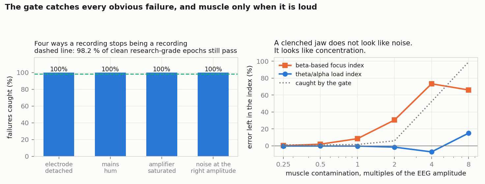
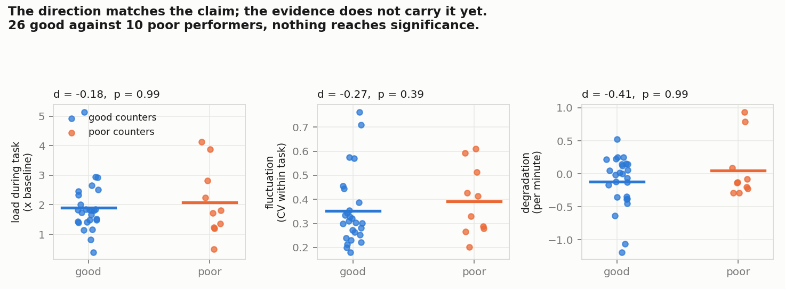
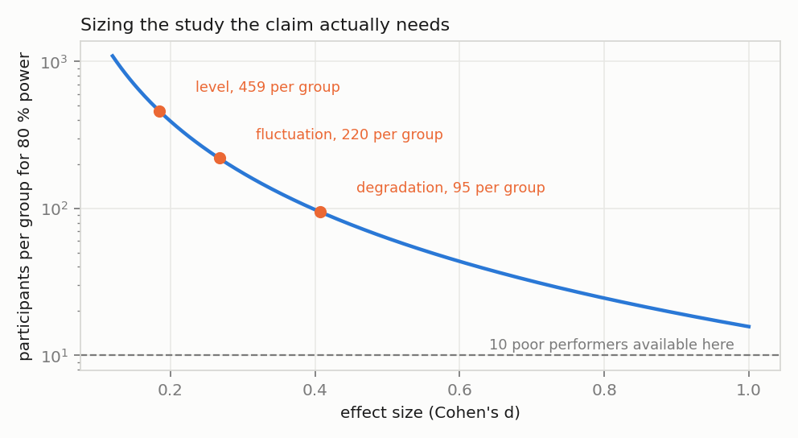
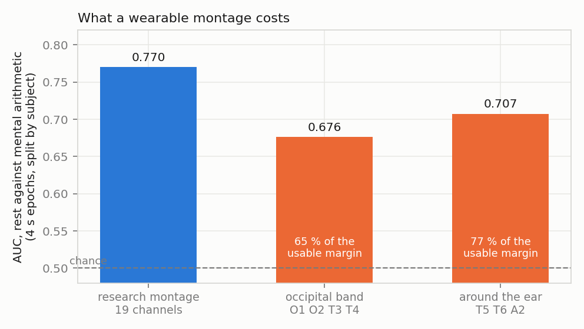

# EEG for stress and focus, under conditions that break EEG

**Before any number about concentration leaves the pipeline, prove the signal was a brain.**

---

> ### Source code is not public
>
> The pipeline is under active development and is used on recordings that are
> not ours to release. The code repository is private; **the source is
> available for technical review under NDA** — contact me through the links at
> the end of this page.
>
> ### Status
>
> Everything here runs on the open PhysioNet dataset *EEG During Mental
> Arithmetic Tasks* — 36 people, 19 channels, rest and serial subtraction.
> No proprietary recordings are used, so every figure can be reproduced by
> anyone. Recordings from our own athlete and captain work are not included.

---

## Backstory

My EEG work started in elite sport, with Khabib Nurmagomedov's team and with Alexander Ovechkin: how does a champion's brain hold up under pressure? Along the way I found something the whole wearables industry had missed. Consumer headbands happily report "focus" from signals that are not brain activity at all. Our 2024 paper in *Sensors* (24(24):8108, doi:10.3390/s24248108) showed that 17 of 19 consumer recordings were non-physiological while the app showed green. This repository is the filter I built to catch that.

## Why EEG

Consumer EEG headsets are now used on athletes, drivers, operators and trainee
captains, and they report focus and stress as numbers on a screen. Two problems
sit underneath that, and both are measurable rather than rhetorical.

The first is that a device always returns a number. In our own head-to-head
against a research amplifier (*Sensors* 24(24):8108), the temporal channels of
one consumer headband produced a non-physiological signal in 17 of 19
recordings while the app displayed green indicators throughout. An instrument
tells you when it cannot measure; a display always shows something.

The second is that athletes move. Dry electrodes sit over the temporalis
muscle, and a clenched jaw produces broadband electrical activity that is
larger than the brain signal underneath it. Whether that matters depends
entirely on which index you compute. That is a question with a number
attached, and this repository puts it on the record.

## Results

### A gate that refuses to answer

Seven checks, each with a physical reason, run per channel per four-second
epoch. A channel that fails any of them contributes nothing to any downstream
figure. Thresholds are set at the 99th and 1st percentile of clean
research-grade epochs, so the gate discards about 1 % of good data — a stated
operating point rather than a tuned one.

| Failure | Caught |
|---|---|
| Electrode detached | **100 %** |
| Mains hum | **100 %** |
| Amplifier saturated | **99.9 %** |
| Noise at the right amplitude, wrong physics | **99.8 %** |
| Clean research-grade data wrongly rejected | 1.8 % |

The first version of this gate caught muscle contamination less than a third of
the time. Two checks were added because of that, a high-frequency ratio and a
kurtosis test. The result is the right-hand panel above, and it is the finding
worth taking away:

| Muscle contamination | Caught | Error left in theta/alpha | Error left in a beta-based index |
|---|---|---|---|
| ×1 of the EEG amplitude | 1.5 % | **−0.4 %** | **+8.4 %** |
| ×2 | 5.8 % | **−1.6 %** | **+30.4 %** |
| ×4 | 52.3 % | −7.2 % | **+73.3 %** |

A jaw clench that the gate does not notice moves a theta/alpha load index by
under two percent and inflates a beta-based "engagement" or "focus" score by
thirty. Beta and gamma sit inside the muscle band; theta and alpha sit below
it. Most consumer focus metrics are built on beta.

So the practical rule this produces is not "filter harder". It is: **on a
moving subject, do not compute focus from beta.**

### Stability, not peak

The interesting claim about elite performers is not that they reach higher
peaks of concentration. It is that their attention **fluctuates less, degrades
slower and recovers faster**. Those are three measurable quantities, and this
dataset can test two of them. The cohort splits into 26 people who counted well
and 10 who counted poorly.

| Metric | Good counters | Poor counters | Cohen's d | p |
|---|---|---|---|---|
| Load level (× baseline) | 1.91 ± 0.90 | 2.09 ± 1.19 | −0.18 | 0.99 |
| Fluctuation (CV within task) | 0.35 ± 0.15 | 0.39 ± 0.14 | −0.27 | 0.39 |
| Degradation (per minute) | −0.12 ± 0.40 | +0.05 ± 0.45 | −0.41 | 0.99 |

Every difference of *means* points the way the claim predicts. **Not one of
them is significant.** On the four-channel occipital montage the fluctuation
difference is larger (d = −0.49) and still not significant. Read by medians or
ranks, two of the three rows point the other way — see "The same table by
ranks" below.

Recovery cannot be tested here at all, because this dataset has no recording
after the task. The estimator is implemented and left unused rather than
filled in with something that looks like an answer.

That gives the number a study design actually needs:

| Effect | Observed d | Participants per group for 80 % power |
|---|---|---|
| Degradation | −0.41 | **95** |
| Fluctuation | −0.27 | **220** |
| Level | −0.18 | 459 |

Ten poor performers is what this dataset offers. The gap between 10 and 95 is
the whole distance between an interesting observation and a result.

### The same table by ranks

Cohen's *d* is a statement about means. The Mann-Whitney *p* beside it is a
statement about ranks, and 0.99 on two of the three rows is not "not
significant" — it is the rank test saying the two groups are interleaved as
evenly as they could be. Reading the 36 subjects again
(`results/rank_check.json`, from the per-subject values in
`results/studies.json`; computed 2026-09-29):

| Metric (full montage) | *d* (means) | 95 % CI on *d* | medians, good vs poor | rank-biserial *r* | Spearman ρ with the score |
|---|---|---|---|---|---|
| Load level | −0.18 | −1.11 to +0.61 | 1.81 vs 1.77 | +0.01 | +0.04 (*p* = 0.83) |
| Fluctuation | −0.27 | −1.16 to +0.38 | 0.31 vs 0.37 | −0.19 | −0.09 (*p* = 0.58) |
| Degradation | −0.41 | −1.10 to +0.37 | −0.01 vs −0.13 | −0.01 | +0.07 (*p* = 0.68) |

Three things follow. The degradation row, the largest *d* in the table and
the one the power calculation leans on, has a rank-biserial correlation of
−0.01: by ranks the groups are indistinguishable, and the poor counters'
*median* degradation is more negative (they improve faster, not slower). Its
*d* is carried by the means of a few subjects — leaving out one subject moves
it from −0.41 to anywhere between −0.50 and −0.18, and the bootstrap interval
spans −1.1 to +0.4. Level goes the same way (medians 1.81 vs 1.77, against
the means). Only fluctuation agrees with itself: means, medians and ranks all
have good counters steadier, and it is the one row that still leans the
predicted way on the four-channel montage (ρ = −0.16, rank-biserial −0.28).

The good/poor split also throws away the score it is made from: subtractions
per session run continuously from 1 to 35 and are cut at 10 vs 11.6. Against
the continuous score the three metrics correlate at |ρ| < 0.10. A study sized
to detect *those* correlations needs about **1 500 participants** for
degradation (1 536), 870 for fluctuation and 5 900 for level — not 95 per
group. The 95 in the power table is the price of the claim if the means are
believed; the ranks say the price is an order of magnitude higher. (Added
2026-11-02: both figures are point estimates — the intervals on ρ cover zero
and both signs, so the price has no finite upper bound; see "Where the cut
sits" below.)

So the honest reading of the stability table is narrower than "every
difference points the right way": one metric out of three does, weakly, and
the other two are noise around zero.

### Where the cut sits

Every number in the two tables above is a property of one choice: the
continuous score (1 to 35 subtractions in four minutes) was cut at 10 vs
11.6, 26 good counters against 10 poor. On this cohort the cut can sit in 27
places that leave at least five subjects on each side with no tie across it.
Reading the table at every one of them (`results/cut_check.json`, from the
per-subject values in `results/studies.json`; computed 2026-11-02):

| Metric (full montage) | *d* at the published cut | *d* over the 27 cuts | cuts with *d* < 0 | cuts with rank-biserial < 0 | *d* at the median split (18 vs 18) | smallest *p* at any cut |
|---|---|---|---|---|---|---|
| Load level | −0.18 | −0.23 to +0.56 | 74 % | 41 % | −0.07 | 0.204 |
| Fluctuation | −0.27 | −0.55 to +0.18 | 74 % | 70 % | +0.05 | 0.094 |
| Degradation | −0.41 | −0.65 to +0.36 | 56 % | 37 % | −0.05 | 0.168 |

No cut makes any row significant; the smallest *p* the sweep can find is
0.094 (fluctuation, with 30 poor against 6 good). The degradation row, the
one the power table leans on, is negative at 15 of 27 cuts and its
rank-biserial at 10 of 27. Its *d* runs from −0.65 (7 poor, cut between 8.6
and 9.0) to +0.36, and the sign follows the half of the score the cut sits
in: it is negative at 15 of the 16 cuts that put 20 or fewer subjects in the
poor group (+0.004 at the sixteenth) and positive at all 11 cuts above that —
among the better counters, the better ones degrade *more*. The published
−0.41 is neither the largest nor the smallest value the data can give; it is
where the cut happened to fall. At the median split all three rows sit
within ±0.07 of zero.

On the four-channel montage, fluctuation is the one row that does not
depend on the cut: *d* is negative at all 27 cuts (−0.71 to −0.01),
rank-biserial at 26 of them, −0.19 at the median split — and never
significant (smallest *p* 0.122). Level and degradation there behave as on
the full montage (78 % and 52 % of cuts negative).

**The sample sizes are point estimates.** The "1 536 / 870 / 5 900
participants" above were computed from the Spearman ρ of each metric with
the continuous score. Bootstrapped over subjects (5 000 resamples):

| Metric (full montage) | ρ with the score | 95 % CI on ρ | resamples with ρ < 0 | participants at the point estimate | participants at the far edge of the CI |
|---|---|---|---|---|---|
| Load level | +0.04 | −0.33 to +0.40 | 42 % | 5 872 | 47 |
| Fluctuation | −0.09 | −0.43 to +0.26 | 69 % | 870 | 40 |
| Degradation | +0.07 | −0.25 to +0.39 | 34 % | 1 536 | 49 |

Every interval covers zero and both signs. The sample a study "needs"
therefore runs from about 40–50 participants (if the true ρ sits at the edge
of the interval) to no finite number (if it is zero): the 1 536 illustrates
the price of the claim, it does not estimate it. The same holds for the *d*
intervals in the previous section — the degradation interval −1.1 to +0.4
reads as 14 per group to no finite number, and the 95 in the power table is
the same kind of illustration.

**Three location estimates per row** (good − poor; the difference of means
is what *d* is built on):

| Metric (full montage) | difference of means | Hodges–Lehmann (median of pairwise differences) | 20 %-trimmed means |
|---|---|---|---|
| Load level | −0.182 | +0.005 | −0.084 |
| Fluctuation | −0.040 | −0.041 | −0.060 |
| Degradation | −0.168 | −0.016 | +0.059 |

Degradation changes sign once the tails are trimmed: the whole row lives in
the tails. Fluctuation is the only row where the three agree, on both
montages (headband −0.074 / −0.064 / −0.080); on the headband, level and
degradation both flip (+0.162 / +0.285 and +0.042 / +0.098 against negative
means).

**Three rows pointing one way.** "Every difference of means points the way
the claim predicts" — how often does that happen with no effect at all? The
good/poor labels were permuted 20 000 times with the three metrics kept
together, so their correlations survive (level–fluctuation *r* = +0.30, the
other pairs |*r*| < 0.10). All three *d* come out negative in **14.0 % of
permutations** — one time in seven. All three at least as negative as the
observed values: 1.6 %. That is the one small number this table yields, and
it is one-sided, chosen after seeing the data, computed on a dichotomised
score, with two rows whose ranks and trimmed means point the other way. Both
figures are reported; neither is a *p*-value for the claim. (Headband:
12.6 % and 1.4 %.)

**The four-channel montage, by ranks** — the rows `rank_check.json` has held
since 2026-09-29 and the page did not show:

| Metric (4-channel) | *d* (means) | 95 % CI on *d* | medians, good vs poor | rank-biserial *r* | Spearman ρ with the score | participants at ρ | per group at *d* |
|---|---|---|---|---|---|---|---|
| Load level | −0.06 | −0.94 to +0.91 | 2.02 vs 1.70 | +0.12 | +0.01 (*p* = 0.96) | 99 502 | 4 596 |
| Fluctuation | −0.49 | −1.45 to +0.22 | 0.36 vs 0.42 | −0.28 | −0.16 (*p* = 0.36) | 311 | 66 |
| Degradation | −0.25 | −1.05 to +0.70 | −0.10 vs −0.22 | +0.06 | +0.10 (*p* = 0.58) | 859 | 246 |

What this does not show: it is one dataset of 36 seated adults, and the 27
cuts share those subjects, so "74 % of cuts" describes this sample, not a
probability. The bootstrap on 36 subjects is itself a wide instrument. The
1.6 % is one-sided and post hoc. Nothing here says whether the three metrics
measure attention at all, or anything about athletes.

## Montages

Wearable EEG puts electrodes where a headband or a pair of headphones can
comfortably sit, not where the signal is. The open dataset carries the full
10-20 montage, so the cost can be measured directly. Classify rest against
mental arithmetic per four-second epoch, split by subject, once with all
channels and once with only the positions each device actually has.

| Montage | Channels | AUC | Share of the usable margin |
|---|---|---|---|
| Research, full 10-20 | 19 | **0.770** | 100 % |
| Around the ear: T5, T6, A2 | 3 | 0.707 | **77 %** |
| Occipital band: O1, O2, T3, T4 | 4 | 0.676 | **65 %** |

Two thirds of the discriminative margin survives on four dry channels. That is
better than the hardware deserves and worse than the marketing implies, and it
is the number to quote when someone asks what a head-worn device can do.

Note the ordering. Three temporal channels beat four occipital-plus-temporal
ones on this task. Position matters more than count.

## What is missing

- Validation on athletes. There is none. The dataset is seated adults doing
  arithmetic.
- Support for the stability hypothesis. It is not supported at this sample
  size. The direction of the three mean differences is consistent at the
  published 10-vs-11.6 cut and at about half of the other admissible cuts
  (degradation: 15 of 27; fluctuation on the four-channel montage is the one
  row consistent at every cut), and the required sample is a point estimate
  with no finite upper bound — see "Where the cut sits". (Until 2026-11-02
  this bullet read "only the direction is consistent, and the required
  sample is now known".)
- Equivalence between a gated consumer headset and a research amplifier. The
  gate makes the headset *truthful* about when it cannot measure, which is a
  different and smaller claim.

## Working log

This repository exists because I had made three public claims and had no
numbers under them. That elite performers fluctuate less, degrade slower and
recover faster. That EEG can yield biomarkers of cognitive control and
resilience. And that the meaningful neural patterns can be separated from
interference caused by movement, muscle tension and surrounding equipment. The
figures above are what I could put under those claims with open data.

The gate was not right first time. Its first version caught muscle
contamination less than a third of the time, and the high-frequency ratio and
kurtosis checks were added because of that.

Recovery after a task has no estimate here. The estimator is written, but the
dataset has no post-task recording, so it stays unused.

The wearable devices we record with sample at a lower rate than the open
dataset. The pipeline resamples, but a native-rate check on real device files
is still to do. Our own athlete recordings are not in this repository and were
not used for any figure. A benchmark that rests on one participant is a
reference point, not a scale; the power table says what closing that gap would
cost.

## References

Zyma, Tukaev, Seleznov et al., *Electroencephalograms during Mental Arithmetic
Task Performance*, Data 4(1):14 (2019); dataset on PhysioNet as `eegmat` 1.0.0 ·
Mikhaylov, Saeed, Alhosani, Al Wahedi, *Comparison of EEG Signal Spectral
Characteristics Obtained with Consumer- and Research-Grade Devices*, Sensors
24(24):8108 · Pope, Bogart & Bartolome (1995) for the beta-based engagement
index.

## Licence

Documentation, figures and result files in this repository: CC BY 4.0. Source
code is held in a private repository, all rights reserved, and is available
under NDA.

### Contact

**Prof. Dr. Dmitry Mikhaylov** — Abu Dhabi, UAE

[LinkedIn](https://www.linkedin.com/in/dmitry-mikhaylov) ·
[ORCID](https://orcid.org/0009-0009-2108-6820) ·
[Substack](https://dmitrymikhaylov.substack.com)
